# Practice 1 CI/CD Pipeline

This diagram shows the flow implemented by the Practice 1 `Jenkinsfile`.

```mermaid
flowchart LR
    developer([Developer])
    github[(GitHub<br/>p1-simple-java-app)]

    subgraph jenkins["Jenkins pipeline"]
        direction LR
        checkout["1. Checkout<br/><code>checkout scm</code>"]
        locate["2. Locate Maven project<br/>standalone or monorepo"]
        build["3. Build and test<br/><code>mvn clean verify</code>"]
        tests[(JUnit results)]
        artifact[(Build artifact<br/><code>practice-1.jar</code>)]
        mainGate{"Building<br/><code>main</code>?"}
        ready["4. Deploy stage<br/>mark artifact ready"]
        failed([Pipeline failed])
    end

    operator([Operator])
    app["Java application<br/><code>java -jar practice-1.jar</code>"]
    health["Health endpoint<br/><code>/health</code> returns <code>UP</code>"]

    developer -->|git push| github
    github -->|webhook or manual build| checkout
    checkout --> locate --> build
    build -->|test reports| tests
    build -->|successful package| artifact
    build -.->|build or test error| failed
    artifact --> mainGate
    mainGate -->|yes| ready
    mainGate -.->|no| artifact
    ready -->|download tested JAR| operator
    operator --> app --> health

    classDef source fill:#f3e8ff,stroke:#7e22ce,color:#3b0764,stroke-width:2px;
    classDef jenkinsStep fill:#dbeafe,stroke:#2563eb,color:#172554,stroke-width:2px;
    classDef output fill:#dcfce7,stroke:#16a34a,color:#14532d,stroke-width:2px;
    classDef decision fill:#fef3c7,stroke:#d97706,color:#78350f,stroke-width:2px;
    classDef failure fill:#fee2e2,stroke:#dc2626,color:#7f1d1d,stroke-width:2px;

    class developer,github source;
    class checkout,locate,build,ready jenkinsStep;
    class tests,artifact,operator,app,health output;
    class mainGate decision;
    class failed failure;
```

The archived JAR is the exact package that passed the automated tests. Practice 1 intentionally leaves application startup as a manual deployment step.
