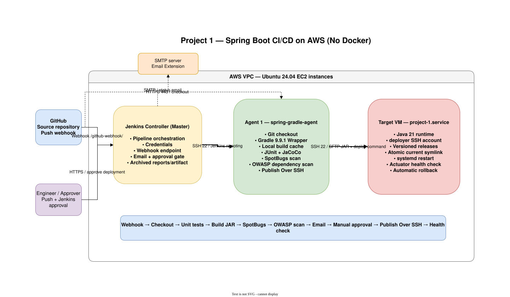
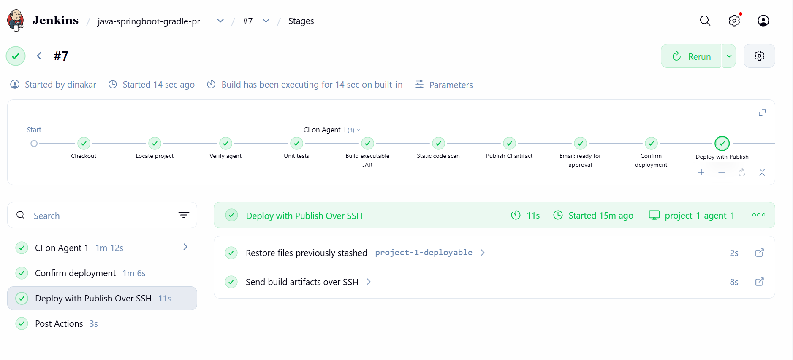

# Project 1: Spring Boot, Gradle, Security Scans, and AWS Deployment

This project builds and deploys a Spring Boot application without Docker.

```text
GitHub webhook
  -> Jenkins controller
  -> Agent 1: tests, Gradle build cache, JAR, security scans
  -> email notification
  -> manual deployment approval
  -> Publish Over SSH
  -> Target VM: systemd service and health check
```

Open [architecture.drawio](architecture.drawio) in draw.io to edit the architecture diagram.





## Project layout

```text
projects/project-1/
|-- architecture.drawio
|-- README.md
|-- SETUP.md
|-- scripts/
|   |-- controller-setup.sh
|   |-- agent-setup.sh
|   `-- target-setup.sh
`-- code/
    |-- Jenkinsfile
    |-- build.gradle
    |-- gradle.properties
    |-- gradlew
    |-- settings.gradle
    `-- src/
```

## What the pipeline does

1. GitHub sends a push webhook.
2. Jenkins runs the job on Agent 1.
3. Gradle runs unit tests and creates coverage reports.
4. Gradle creates `project-1.jar` using the local build cache.
5. SpotBugs performs static code analysis.
6. OWASP Dependency-Check scans dependencies for known vulnerabilities.
7. Jenkins archives the JAR and reports.
8. Jenkins sends an email requesting deployment approval.
9. An authorized Jenkins user approves or rejects deployment.
10. Publish Over SSH transfers the JAR to the target VM.
11. The target deployment script restarts the systemd service and checks health.
12. A failed health check rolls back to the previous release.

For infrastructure preparation, Jenkins configuration, deployment verification, and troubleshooting, follow the [detailed setup guide](SETUP.md).

## Completion checklist

- Three Ubuntu 24.04 EC2 instances are running.
- Jenkins controller is accessible and plugins are installed.
- Agent 1 is online with label `spring-gradle-agent`.
- Publish Over SSH configuration is named `project-1-target`.
- SMTP test email succeeds.
- Secret Text credential `nvd-api-key` exists.
- GitHub webhook starts the job.
- Unit tests, SpotBugs, and Dependency-Check pass.
- The approval email arrives.
- An authorized user approves deployment.
- Target `/actuator/health` returns `UP`.
- A repeat build shows Gradle `FROM-CACHE` tasks.

## Version and reference notes

- Spring Boot `4.1.2`, Java `21`
- Gradle Wrapper `9.9.1` with distribution checksum verification
- SpotBugs Gradle plugin `6.5.13`
- OWASP Dependency-Check Gradle plugin `13.0.0`

References:

- [Spring Boot system requirements](https://docs.spring.io/spring-boot/system-requirements.html)
- [Gradle build cache](https://docs.gradle.org/current/userguide/build_cache.html)
- [OWASP Dependency-Check Gradle configuration](https://dependency-check.github.io/DependencyCheck/dependency-check-gradle/configuration.html)
- [Jenkins Publish Over SSH](https://plugins.jenkins.io/publish-over-ssh/)
- [Jenkins Email Extension](https://plugins.jenkins.io/email-ext/)
- [Jenkins Ubuntu installation](https://www.jenkins.io/doc/book/installing/linux/)
