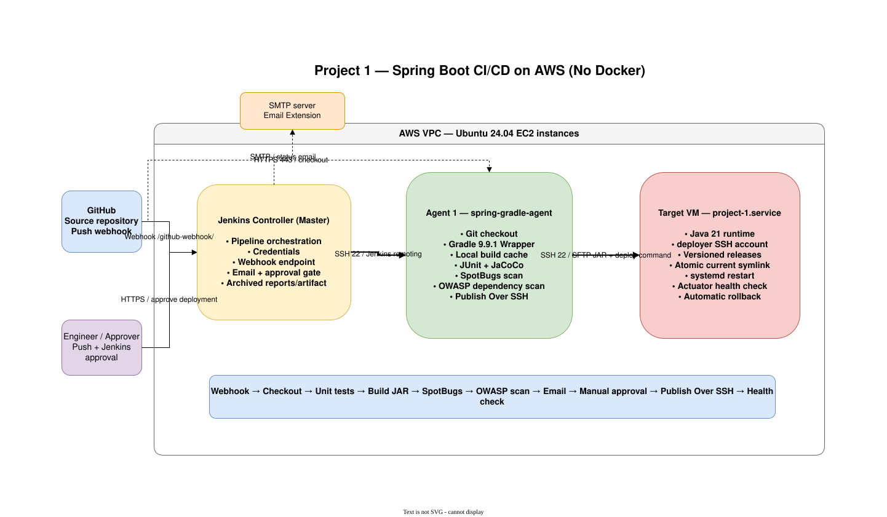

# Project 1: Spring Boot, Gradle, Security Scans, and AWS Deployment

This project builds and deploys a Spring Boot application without Docker.

```text
GitHub webhook
  -> Jenkins controller
  -> Agent 1: tests, Gradle build cache, JAR, security scans
  -> email notification
  -> manual deployment approval
  -> Publish Over SSH
  -> Target VM: systemd service and health check
```

Open [architecture.drawio](architecture.drawio) in draw.io to edit the architecture diagram.  
  



## Project layout

```text
projects/project-1/
|-- architecture.drawio
|-- Jenkinsfile
|-- project-1.md
|-- scripts/
|   |-- controller-setup.sh
|   |-- agent-setup.sh
|   `-- target-setup.sh
`-- code/
    |-- build.gradle
    |-- gradle.properties
    |-- gradlew
    |-- settings.gradle
    `-- src/
```

## What the pipeline does

1. GitHub sends a push webhook.
2. Jenkins runs the job on Agent 1.
3. Gradle runs unit tests and creates coverage reports.
4. Gradle creates `project-1.jar` using the local build cache.
5. SpotBugs performs static code analysis.
6. OWASP Dependency-Check scans dependencies for known vulnerabilities.
7. Jenkins archives the JAR and reports.
8. Jenkins sends an email requesting deployment approval.
9. An authorized Jenkins user approves or rejects deployment.
10. Publish Over SSH transfers the JAR to the target VM.
11. The target deployment script restarts the systemd service and checks health.
12. A failed health check rolls back to the previous release.

## Step 1: Create the three AWS EC2 instances

Create three Ubuntu Server 24.04 instances in the same VPC:

| Instance | Purpose | Suggested name |
|---|---|---|
| Controller | Jenkins UI, credentials, orchestration | `jenkins-controller` |
| Agent 1 | Java/Gradle build, tests, scans, SSH publishing | `jenkins-agent-1` |
| Target | Runs the Spring Boot systemd service | `project-1-target` |

Use your normal EC2 key pair only for initial administration. The setup scripts create or install dedicated Jenkins keys.

### Security groups

Create separate security groups and use security-group references when possible:

**Controller security group**

- TCP `22` from your IP
- TCP `8080` from your IP
- TCP `8080` from the current GitHub webhook CIDRs, or expose Jenkins through a secured HTTPS endpoint

**Agent security group**

- TCP `22` from the Controller security group
- TCP `22` from your IP for administration, if needed

**Target security group**

- TCP `22` from the Agent security group
- TCP `22` from the Controller security group so Publish Over SSH **Test Configuration** can run
- TCP `22` from your IP for administration, if needed
- TCP `8080` from your IP for application testing

All three instances need outbound HTTPS `443`. Agent 1 uses it for GitHub, Gradle, Maven Central, Gradle Plugin Portal, and NVD data.

GitHub webhook IP ranges change. Retrieve the current list instead of copying old CIDRs:

```bash
curl -fsSL https://api.github.com/meta | jq -r '.hooks[]'
```

For a longer-lived setup, place Jenkins behind HTTPS and avoid exposing raw port `8080` broadly.

## Step 2: Push the repository to GitHub

From the repository root:

```powershell
git add projects/project-1
git update-index --chmod=+x projects/project-1/code/gradlew
git commit -m "Add project-1 Spring Boot Gradle pipeline"
git push
```

The Jenkins Script Path will be:

```text
projects/project-1/Jenkinsfile
```

## Step 3: Configure the Jenkins controller VM

Copy `scripts/controller-setup.sh` to the controller and run:

```bash
chmod +x controller-setup.sh
sudo ./controller-setup.sh
```

The script installs Java 21 and Jenkins LTS, starts Jenkins, creates two dedicated SSH key pairs, and prints the data needed for the agent and target.

Open Jenkins:

```text
http://CONTROLLER_PUBLIC_IP:8080
```

Get the initial password with the command printed by the script.

Install these plugins:

- Pipeline
- Git
- GitHub
- JUnit
- SSH Build Agents
- Publish Over SSH
- Email Extension
- Credentials Binding

## Step 4: Configure Agent 1

Copy `scripts/agent-setup.sh` to Agent 1. Copy the `controller-to-agent.pub` value printed by the controller script and run:

```bash
chmod +x agent-setup.sh
sudo -E AGENT_SSH_PUBLIC_KEY='PASTE_CONTROLLER_TO_AGENT_PUBLIC_KEY' ./agent-setup.sh
```

The script prints the exact node values. In Jenkins:

1. Open **Manage Jenkins > Credentials**.
2. Add **SSH Username with private key**.
3. Username: `jenkins-agent`.
4. Paste the controller file `/root/project-1-bootstrap-keys/controller-to-agent`.
5. Credential ID: `project-1-agent-ssh`.
6. Open **Manage Jenkins > Nodes > New Node**.
7. Node name: `project-1-agent-1`.
8. Type: **Permanent Agent**.
9. Remote root: `/home/jenkins-agent/agent`.
10. Label: `spring-gradle-agent`.
11. Usage: **Only build jobs with label expressions matching this node**.
12. Launch method: **Launch agents via SSH**.
13. Host: Agent 1 private IP.
14. Credential: `project-1-agent-ssh`.
15. Verify the SSH host fingerprint printed by the script.
16. If Jenkins cannot find Java, use the JavaPath printed by the script.

Save and confirm that the node is **Online**.

## Step 5: Configure the target VM

Copy `scripts/target-setup.sh` to the target VM. Use the `jenkins-to-target.pub` value printed by the controller script:

```bash
chmod +x target-setup.sh
sudo -E TARGET_SSH_PUBLIC_KEY='PASTE_JENKINS_TO_TARGET_PUBLIC_KEY' ./target-setup.sh
```

The script creates:

- the unprivileged `springapp` service account
- the restricted `deployer` SSH account
- `/opt/project-1/releases`
- `project-1.service`
- `/usr/local/sbin/deploy-project-1.sh`
- an exact sudo rule for only that deployment command
- health-check rollback to the previous release

The service remains stopped until the first successful deployment.

## Step 6: Configure Publish Over SSH

On the controller, display the target private key:

```bash
sudo cat /root/project-1-bootstrap-keys/jenkins-to-target
```

In Jenkins, open **Manage Jenkins > System > Publish over SSH**.

Configure the private key, then add an SSH server:

```text
Name:              project-1-target
Hostname:          TARGET_PRIVATE_IP
Username:          deployer
Remote Directory:  /home/deployer
Port:              22
```

Select **Test Configuration**. If it fails, check the target security group, public key, username, and SSH host fingerprint.

The `Name` must exactly match `project-1-target` in the Jenkinsfile.

## Step 7: Configure email

Open **Manage Jenkins > System** and configure **Extended E-mail Notification**:

1. Enter your SMTP server and port.
2. Add SMTP credentials in Jenkins Credentials when authentication is required.
3. Enable TLS/SSL as required by your mail provider.
4. Set a default sender address.
5. Send a test email.

The job parameter `NOTIFICATION_EMAIL` controls the recipient. If it is empty, the pipeline continues but skips email.

## Step 8: Configure the NVD API key

OWASP Dependency-Check uses NVD vulnerability data. Request an API key from:

```text
https://nvd.nist.gov/developers/request-an-api-key
```

In **Manage Jenkins > Credentials**, add:

```text
Kind: Secret text
ID:   nvd-api-key
Secret: your NVD API key
```

The first dependency scan downloads vulnerability data and can take longer. Later scans reuse data under `/home/jenkins-agent/.gradle`.

## Step 9: Create the Jenkins Pipeline job

1. Select **New Item**.
2. Name it `project-1-job`.
3. Select **Pipeline**.
4. Under Pipeline, choose **Pipeline script from SCM**.
5. SCM: **Git**.
6. Repository URL: your GitHub repository.
7. Add repository credentials if it is private.
8. Branch Specifier: `*/main`.
9. Script Path: `projects/project-1/Jenkinsfile`.
10. Save.

Run **Build Now** once. This loads the parameters and the `githubPush()` trigger from the Jenkinsfile.

For the first build use:

```text
NOTIFICATION_EMAIL = your email address
APPROVER_USERS     = your Jenkins user ID, for example admin
```

## Step 10: Add the GitHub webhook

In GitHub open **Repository > Settings > Webhooks > Add webhook**:

```text
Payload URL:  http://CONTROLLER_PUBLIC_IP:8080/github-webhook/
Content type: application/json
Events:       Just the push event
Active:       enabled
```

Use your HTTPS Jenkins URL instead when available. The trailing slash in `/github-webhook/` matters.

Push a small change. GitHub should deliver the webhook and Jenkins should start automatically.

## Step 11: Follow the pipeline

Expected stages:

```text
Checkout
Verify agent
Unit tests
Build executable JAR
Static code scan
Dependency security scan
Publish CI artifact
Email: ready for approval
Confirm deployment
Deploy with Publish Over SSH
```

Check the build page for:

- **Test Result** — three passing tests
- **Artifacts** — `project-1.jar`, SpotBugs report, Dependency-Check report, test and coverage reports
- Console lines containing `FROM-CACHE` on repeat builds

Dependency-Check fails the pipeline for a dependency with CVSS `7.0` or higher. SpotBugs also fails on reported medium/high findings.

## Step 12: Approve deployment

After CI and scans pass, Jenkins sends the approval email and pauses without occupying Agent 1.

Open the build and choose:

- **Deploy** — continue to the target VM
- **Abort** — stop without deployment

Only the Jenkins IDs in `APPROVER_USERS` may approve. The approval times out after 30 minutes.

## Step 13: Verify the target VM

After deployment:

```bash
curl http://TARGET_PRIVATE_IP:8080/
curl 'http://TARGET_PRIVATE_IP:8080/api/hello?name=AWS'
curl http://TARGET_PRIVATE_IP:8080/actuator/health
```

Expected health response:

```json
{"status":"UP"}
```

On the target:

```bash
systemctl status project-1 --no-pager
sudo journalctl -u project-1 -n 100 --no-pager
readlink -f /opt/project-1/current
```

## Step 14: Confirm Gradle build-cache reuse

Run the job again without changing code. In Console Output, Gradle should mark reusable tasks with:

```text
FROM-CACHE
```

The cache is enabled in `code/gradle.properties` and stored persistently in `/home/jenkins-agent/.gradle`.

## Troubleshooting

### Job stays queued

Agent 1 must be online with label `spring-gradle-agent`.

### Gradle Wrapper is not executable

On Agent 1 or locally:

```bash
chmod +x projects/project-1/code/gradlew
```

Commit the executable permission to Git.

### `nvd-api-key` credential is missing

Create the Secret Text credential using the exact ID `nvd-api-key`.

### Dependency scan takes a long time

The first NVD database population is slow. Confirm the API key and preserve `/home/jenkins-agent/.gradle` between builds.

### Email is not sent

Test Extended E-mail Notification under **Manage Jenkins > System** and provide `NOTIFICATION_EMAIL` when starting the build.

### Publish Over SSH cannot connect

Confirm:

- configuration name is `project-1-target`
- target port `22` allows the Agent and Controller security groups
- username is `deployer`
- the private key matches the target authorized key
- Remote Directory is `/home/deployer`

### Deployment command is denied by sudo

On the target:

```bash
sudo -l -U deployer
sudo visudo -cf /etc/sudoers.d/project-1-deployer
```

### Target health check fails

On the target:

```bash
sudo journalctl -u project-1 -n 100 --no-pager
curl -v http://127.0.0.1:8080/actuator/health
```

The deployment script automatically restores the previous release when the new release does not become healthy.

## Completion checklist

- Three Ubuntu 24.04 EC2 instances are running.
- Jenkins controller is accessible and plugins are installed.
- Agent 1 is online with label `spring-gradle-agent`.
- Publish Over SSH configuration is named `project-1-target`.
- SMTP test email succeeds.
- Secret Text credential `nvd-api-key` exists.
- GitHub webhook starts the job.
- Unit tests, SpotBugs, and Dependency-Check pass.
- The approval email arrives.
- An authorized user approves deployment.
- Target `/actuator/health` returns `UP`.
- A repeat build shows Gradle `FROM-CACHE` tasks.

## Version and reference notes

- Spring Boot `4.1.2`, Java `21`
- Gradle Wrapper `9.9.1` with distribution checksum verification
- SpotBugs Gradle plugin `6.5.13`
- OWASP Dependency-Check Gradle plugin `13.0.0`

References:

- [Spring Boot system requirements](https://docs.spring.io/spring-boot/system-requirements.html)
- [Gradle build cache](https://docs.gradle.org/current/userguide/build_cache.html)
- [OWASP Dependency-Check Gradle configuration](https://dependency-check.github.io/DependencyCheck/dependency-check-gradle/configuration.html)
- [Jenkins Publish Over SSH](https://plugins.jenkins.io/publish-over-ssh/)
- [Jenkins Email Extension](https://plugins.jenkins.io/email-ext/)
- [Jenkins Ubuntu installation](https://www.jenkins.io/doc/book/installing/linux/)

