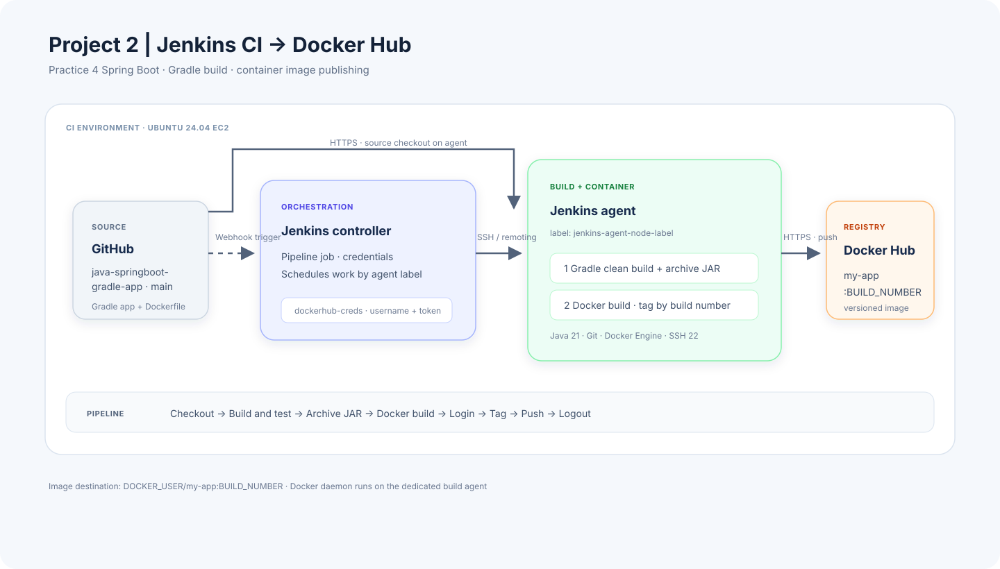
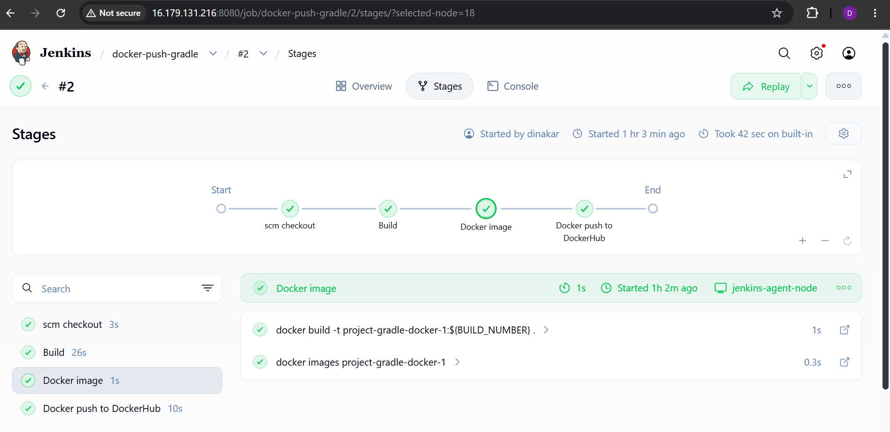

# Project 2: Spring Boot CI to Docker Hub

Jenkins builds the Practice 4 Spring Boot application with Gradle on a dedicated agent, packages it as a Docker image, and pushes a build-number tag to Docker Hub. The controller schedules the pipeline; the agent runs Git, Java 21, Gradle, and Docker.

Edit the diagram in [architecture.drawio](architecture.drawio). This is a completed Jenkins run:

## Pipeline at a glance

| Stage | Result |
|---|---|
| SCM checkout | Pulls `d-invisible/java-springboot-gradle-app` from `main` onto the agent |
| Build | Runs Gradle build and archives `project-1.jar` |
| Docker image | Builds `project-gradle-docker-2:BUILD_NUMBER` |
| Docker push to DockerHub | Pushes `DOCKER_USER/my-app:BUILD_NUMBER` with Jenkins credentials |

The app serves `/`, `/api/hello?name=Asha`, and `/actuator/health`. The [app code](code/README.md) comes from Practice 4; its existing JAR name is `project-1.jar`.

## Files

| Path | Purpose |
|---|---|
| `aws-script/setup-aws.sh` | Creates Ubuntu EC2 instances, key pair, and security groups |
| `scripts/controller-setup.sh` | Installs Jenkins and creates the controller-to-agent SSH key |
| `scripts/agent-setup.sh` | Installs Java, Git, SSH, and Docker on the agent |
| `code/Jenkinsfile` | Defines the four pipeline stages |
| `code/Dockerfile` | Packages the Gradle JAR into a Java 21 image |

Follow [SETUP.md](SETUP.md) for the complete order, commands, Jenkins configuration, and checks.
